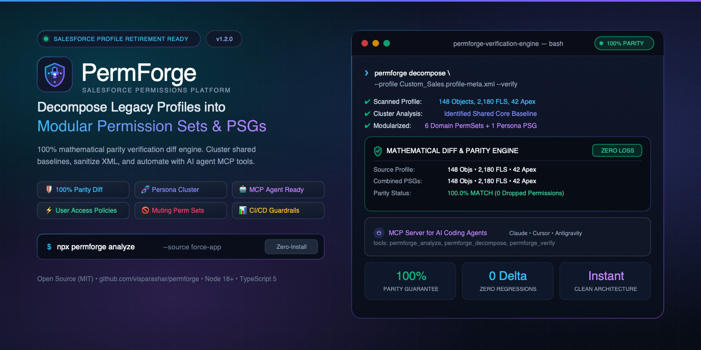
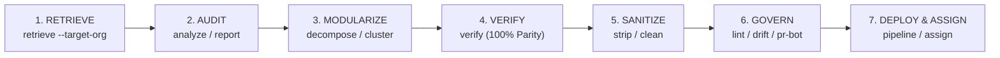
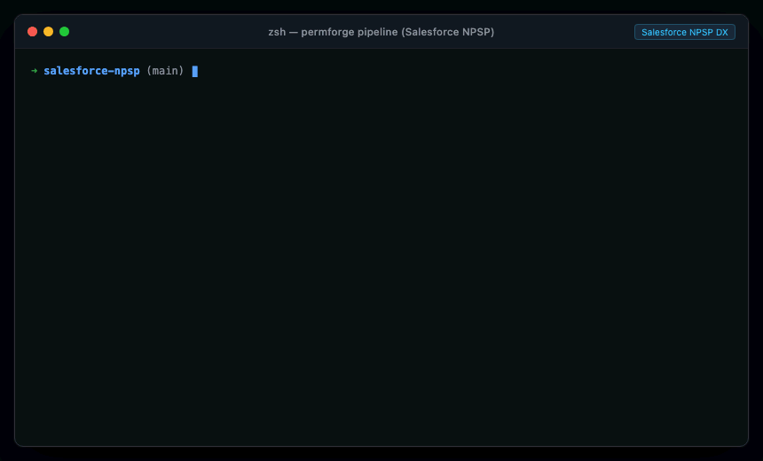
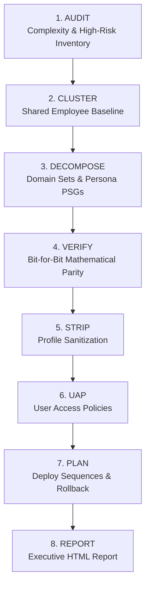

<p align="center">
  <picture>
    <source media="(prefers-color-scheme: dark)" srcset="docs/assets/banner.svg">
    
  </picture>
</p>

# 🛡️ PermForge

[](https://opensource.org/licenses/MIT)
[](https://visparashar.github.io/permforge/)
[](https://nodejs.org)
[](https://www.typescriptlang.org/)
[](https://github.com/visparashar/permforge)
[](https://modelcontextprotocol.io/)
[](vscode-extension)

> **The Complete, Open-Source Salesforce Profile to Permission Set & Permission Set Group Migration Platform.**
>
> 🌐 **Live Website & Documentation:** [https://visparashar.github.io/permforge/](https://visparashar.github.io/permforge/) &bull; 🗺️ **[Product Roadmap](ROADMAP.md)**

---

## ⚡ The Challenge: Salesforce Profile Sunset

Salesforce has officially announced the retirement of permissions on legacy Profiles. Moving forward, Profiles are restricted purely to one-to-one credential settings (Login Hours, IP Ranges, Default Page Layouts, Default Record Types). All functional permissions—Object CRUD, Field-Level Security (FLS), System User Permissions, and Apex Class Access—must be migrated to **Permission Sets** and **Permission Set Groups (PSGs)**.

### Why Migrating by Hand Fails

1. **The 1:1 Monolithic Trap:** Naively converting a Profile into a single giant Permission Set copies all technical debt into a new folder.
2. **Intractable Untangling:** Manually splitting hundreds of objects and thousands of fields takes weeks of error-prone clicking in the Setup UI.
3. **Fear of Regressions:** A single missing FLS or Object permission breaks business operations, integrations, or reports.
4. **CI/CD Drift:** Developers accidentally re-introduce profile permissions in Git merges during day-to-day development.

---

## 🚀 The Solution: PermForge

**PermForge** provides an end-to-end automated lifecycle to audit, modularize, verify, sanitize, and govern your Salesforce permissions:



### 🎥 Live Demo: Migrating Salesforce NPSP (Nonprofit Success Pack)



---

## 📦 Installation

### Global CLI

```bash
npm install -g permforge
```

### Run via `npx` (Zero Installation)

```bash
npx permforge --help
```

### Install as Library

```bash
npm install permforge
```

### 🖥️ Visual Studio Code Extension

Prefer an interactive GUI? Use the official **[PermForge VS Code Extension](vscode-extension)**:

- **Sidebar Explorers**: Live profile debt badges (`🟢 Low`, `🟡 Med`, `🔴 High`), SObject/FLS counts, and risk flags.
- **PermForge Migration Studio**: Interactive Webview for visual decomposition, clustering threshold tuning, and mathematical parity proofs.
- **Context Menus**: Right-click any `.profile-meta.xml` or `.profile` file in VS Code to analyze, decompose, or sanitize immediately.

```bash
# Package and install locally
npm run package:vscode
code --install-extension vscode-extension/vscode-permforge-2.0.0.vsix
```

---

## ⚡ Quick Command Reference

| Command                              | Description                                                                                                           |
| ------------------------------------ | --------------------------------------------------------------------------------------------------------------------- |
| **`permforge pipeline`**             | **Full Migration Pipeline:** Executes audit, clustering, parity verification, UAP, and rollout planning in one command.|
| **`permforge retrieve`**             | **Live Org Extraction:** Queries and pulls profile metadata directly from an authenticated live Salesforce org.        |
| **`permforge analyze`**              | Scans profiles, inventories permissions, flags high-risk access, and scores complexity (0–100).                       |
| **`permforge report`**               | Generates an interactive, standalone HTML audit report with security heatmaps and parity tables.                      |
| **`permforge decompose`**            | Decomposes legacy profiles into domain-aligned Permission Sets and Persona-based PSGs.                                |
| **`permforge cluster`**              | Cross-profile clustering: extracts a shared `Standard_Employee_Baseline` and isolates deltas.                         |
| **`permforge verify`**               | Mathematical diff engine proving 100% access parity (zero permissions dropped).                                       |
| **`permforge strip`** _(or `clean`)_ | Removes deprecated permissions from `.profile-meta.xml` while preserving layout assignments & login settings.         |
| **`permforge uap`**                  | Generates native Salesforce **User Access Policies** (`.userAccessPolicy-meta.xml`) for zero-touch provisioning.      |
| **`permforge mute`**                 | Generates **Muting Permission Sets** (`.mutingpermissionset-meta.xml`) to selectively restrict actions (e.g. Delete). |
| **`permforge lint`**                 | CI/CD pre-commit and PR scanner to enforce the zero-profile-permissions standard.                                     |
| **`permforge graph`**                | Visualizes permission architecture hierarchy (PSG -> Permission Sets -> SObjects) in ASCII or Mermaid.                |
| **`permforge plan`**                 | Generates user assignment CSV templates, migration shell scripts, and rollback procedures.                            |
| **`permforge advise`**               | Dynamic Forms readiness advisor and non-default Record Type decoupler (Salesforce 2026).                              |
| **`permforge assign`**               | Live user reassignment from Profiles to PSGs with preview, dry-run simulation, and 1-click rollback.                  |
| **`permforge prune`**                | Usage-driven least-privilege optimizer parsing Event Monitoring telemetry logs to eliminate dormant access.            |
| **`permforge drift`**                | Cross-environment drift guard detecting permission drift between branches or live orgs with auto-reconciliation.       |
| **`permforge compliance`**           | Audits profiles against SOC 2, HIPAA, and ISO 27001 and generates interactive HTML/CSV evidence packages.            |
| **`permforge pr-bot`**               | Automated GitHub Actions PR review bot generating visual security badges, risk callouts, and drift diffs.             |
| **`permforge wizard`**               | Interactive, guided terminal wizard with arrow-key menus.                                                             |
| **`permforge mcp`**                  | Launches native Model Context Protocol (MCP) server for autonomous AI coding assistants.                             |

---

## 📖 5-Minute Migration Walkthrough

Here is the recommended enterprise workflow for migrating a Salesforce repository:

### Step 1: Audit Your Repository

```bash
# Scan and view profile complexity in your terminal
permforge analyze --source force-app/main/default/profiles

# Generate an interactive HTML audit dashboard
permforge report --source force-app/main/default/profiles --output audit-report.html
```

### Step 2: Cluster & Decompose Permissions

```bash
# Analyze all profiles and extract a shared baseline + role deltas
permforge cluster --source force-app/main/default/profiles --threshold 0.75 --output-dir force-app/main/default
```

### Step 3: Verify 100% Security Parity

```bash
# Verify that no user loses access under their new Permission Set Group
permforge verify \
  --profile force-app/main/default/profiles/Sales_User.profile-meta.xml \
  --group force-app/main/default/permissionsetgroups/Sales_User_PSG.permissionsetgroup-meta.xml
```

### Step 4: Sanitize Legacy Profiles

```bash
# Strip deprecated permissions from profiles (creates .bak backup automatically)
permforge strip --source force-app/main/default/profiles --in-place
```

### Step 5: Automate User Provisioning & Governance

```bash
# 1. Create a native User Access Policy to auto-assign the PSG
permforge uap --name Sales_Auto_Assign --group Sales_User_PSG --criteria "Department=Sales"

# 2. Add CI/CD linting check to your GitHub Actions workflow
permforge lint --github-actions
```

---

## 🛠️ CLI Commands & Usage

### 0. `permforge pipeline` (Enterprise All-in-One Engine)

Executes the complete, multi-stage Salesforce Profile migration lifecycle in a single command. The engine coordinates 8 modular stages with configurable quality gates:



```bash
# Execute the full migration pipeline
permforge pipeline --run

# Run full pipeline with cross-profile clustering and UAP generation
permforge pipeline --run --source force-app/main/default/profiles --cluster --uap --plan

# Run full pipeline directly against an authenticated Salesforce org (cloud migration)
permforge pipeline --run --target-org my-sandbox --cluster --strict

# Deploy generated Permission Sets & PSGs to live org after 100% parity verification
permforge pipeline --run --target-org my-sandbox --deploy

# Initialize pipeline configuration and scaffold GitHub Actions CI gate
permforge pipeline --init
```

**Pipeline Flags:**

| Flag | Description | Default |
| --- | --- | --- |
| `--run` | Execute the full multi-stage migration pipeline | `false` |
| `-o, --target-org` | Connect directly to an authenticated Salesforce org (alias or username) | `undefined` |
| `--deploy` | Deploy generated Permission Sets and PSGs to the live org upon completion | `false` |
| `-p, --profiles` | Comma-separated list of profile names to process when targeting a live org | `all custom` |
| `--init` | Scaffolds `permforge.pipeline.json` and `.github/workflows/salesforce-permforge-gate.yml` | `false` |
| `-s, --source` | Directory or glob pattern containing source profiles | `force-app/main/default/profiles` |
| `-d, --output-dir` | Target directory for generated Permission Sets and PSGs | `force-app/main/default` |
| `--cluster` | Enable cross-profile clustering to extract standard baseline | `false` |
| `--strip` | Sanitize source profiles by stripping migratable permissions | `false` |
| `--uap` | Generate native Salesforce User Access Policies (`.userAccessPolicy-meta.xml`) | `false` |
| `--plan` | Generate user assignment CSVs, rollback scripts, and SF CLI deploy sequences | `true` |
| `--strict` | Fail pipeline with exit code 1 if parity < 100% or any stage errors | `false` |
| `--dry-run` | Simulation mode: run all analytical & verification checks without modifying disk | `false` |
| `--json` | Format pipeline output as JSON for programmatic orchestration | `false` |

---

### 1. `permforge retrieve` (Live Org Extraction)

Directly extracts profiles from any authenticated Salesforce org using the Metadata API—without requiring manual Setup exports, change sets, or Ant scripts.

```bash
# List all profiles available in your default or sandbox org
permforge retrieve --list
permforge retrieve --target-org my-sandbox --list

# Retrieve specific profiles to local directory
permforge retrieve --target-org my-sandbox --profiles "Custom_Admin,Sales_User"

# Retrieve all custom profiles in the org
permforge retrieve --target-org my-sandbox --all-custom --output-dir force-app/main/default/profiles
```

---

### 2. `permforge analyze`

Scans your repository for profile metadata, inventories all permissions, flags high-risk access, and calculates a complexity score (0-100).

```bash
# Scan default SFDX profile directory
permforge analyze

# Scan specific directory or profile
permforge analyze --source force-app/main/default/profiles
permforge analyze --source path/to/Custom_Admin.profile-meta.xml

# Output as JSON for CI/CD pipelines
permforge analyze --json
```

**Example Output:**

```text
🔍 PermForge Profile Security & Complexity Analysis

┌──────────────┬────────┬─────────┬────────┬────────────┬──────────────┬───────────┬──────────────┐
│ Profile Name │ Type   │ Objects │ Fields │ User Perms │ Apex Classes │ High Risk │ Complexity   │
├──────────────┼────────┼─────────┼────────┼────────────┼──────────────┼───────────┼──────────────┤
│ Sales_User   │ Custom │ 3       │ 5      │ 3          │ 2            │ 0         │ 19/100 (Low) │
├──────────────┼────────┼─────────┼────────┼────────────┼──────────────┼───────────┼──────────────┤
│ Custom_Admin │ Custom │ 2       │ 0      │ 4          │ 0            │ 8         │ 56/100 (Med) │
└──────────────┴────────┴─────────┴────────┴────────────┴──────────────┴───────────┴──────────────┘

⚠️ High-Risk Permissions Detected:
  • Custom_Admin: ModifyAllData, ViewAllData, ManageUsers, AuthorApex, ModifyAllRecords:Account
```

---

### 2. `permforge cluster`

Analyzes multiple profiles simultaneously to extract a shared **`Standard_Employee_Baseline`** Permission Set for permissions common across your organization (e.g. granted by $\ge 75\%$ of profiles). Generates modular delta permission sets and bundles them into Persona PSGs.

```bash
# Cluster all profiles in the project with default 75% threshold
permforge cluster

# Custom threshold (e.g. 60% of profiles) and custom baseline name
permforge cluster --source force-app/main/default/profiles --threshold 0.6 --base-name "Global_Core_Access"
```

---

### 3. `permforge decompose`

Decomposes a profile into modular Permission Sets and bundles them into a Persona-based Permission Set Group (`.permissionsetgroup-meta.xml`). Automatically runs a parity check upon completion.

```bash
# Decompose a single profile
permforge decompose --source force-app/main/default/profiles/Sales_User.profile-meta.xml

# Decompose all profiles into your project
permforge decompose --source force-app/main/default/profiles --output-dir force-app/main/default

# Choose a strategy: by-domain (default), by-object, or consolidated
permforge decompose --source path/to/Profile.profile-meta.xml --strategy by-domain
```

**Generated Artifacts:**

- `permissionsets/<Profile>_<Domain>.permissionset-meta.xml`: Cohesive SObject CRUD + Field FLS + Tabs + Record Types.
- `permissionsets/<Profile>_System_Permissions.permissionset-meta.xml`: Administrative and user permissions.
- `permissionsets/<Profile>_Apex_Access.permissionset-meta.xml`: Apex classes and Visualforce pages.
- `permissionsets/<Profile>_Custom_Permissions.permissionset-meta.xml`: Custom permissions.
- `permissionsetgroups/<Profile>_PSG.permissionsetgroup-meta.xml`: Ready-to-assign Permission Set Group.

---

### 4. `permforge verify`

Mathematically compares the original Profile against the target Permission Sets / PSG. Verifies whether any object, field, user, or class permissions were omitted or altered.

```bash
# Verify against a Permission Set Group
permforge verify \
  --profile force-app/main/default/profiles/Sales_User.profile-meta.xml \
  --group force-app/main/default/permissionsetgroups/Sales_User_PSG.permissionsetgroup-meta.xml

# Verify against a directory of permission sets
permforge verify \
  --profile force-app/main/default/profiles/Sales_User.profile-meta.xml \
  --permsets-dir force-app/main/default/permissionsets
```

**Example Output:**

```text
🛡️ Access Parity Report: Sales_User

┌────────────────────────────┬─────────┬────────────────────────────┐
│ Category                   │ Status  │ Coverage                   │
├────────────────────────────┼─────────┼────────────────────────────┤
│ Object CRUD & Admin        │ ✔ MATCH │                            │
├────────────────────────────┼─────────┼────────────────────────────┤
│ Field-Level Security (FLS) │ ✔ MATCH │                            │
├────────────────────────────┼─────────┼────────────────────────────┤
│ System User Permissions    │ ✔ MATCH │                            │
├────────────────────────────┼─────────┼────────────────────────────┤
│ Apex & VF Access           │ ✔ MATCH │                            │
├────────────────────────────┼─────────┼────────────────────────────┤
│ Overall Parity             │ 100.0%  │ 24/24 permissions verified │
└────────────────────────────┴─────────┴────────────────────────────┘

✔ PERFECT MATCH: All permissions from original profile are fully preserved.
```

---

### 5. `permforge strip` (or `clean`)

Sanitizes legacy profiles by removing all deprecated permissions (Object, Field FLS, User Perms, Apex classes) while preserving necessary layout assignments, default record types, and login settings.

```bash
# Strip permissions in-place with automatic .bak backup
permforge strip --source force-app/main/default/profiles --in-place

# Output sanitized profiles to a separate directory
permforge strip --source force-app/main/default/profiles --output-dir force-app/main/default/clean-profiles
```

---

### 6. `permforge uap`

Generates native Salesforce **User Access Policy (UAP)** metadata (`.userAccessPolicy-meta.xml`) to automate continuous, zero-touch user provisioning when users are created or updated.

```bash
# Auto-assign PSG when User.Department is Sales
permforge uap \
  --name Sales_User_Auto_Assign \
  --group Sales_User_PSG \
  --criteria "Department=Sales,UserType=Standard"
```

---

### 7. `permforge mute`

Generates a **Muting Permission Set** (`.mutingpermissionset-meta.xml`) targeting a Permission Set Group to selectively restrict sensitive actions (e.g. Delete) for junior or contractor roles without cloning permission set groups.

```bash
# Mute Delete on Account and Opportunity in a PSG
permforge mute --name Sales_Junior_Mute --mute-delete Account,Opportunity
```

---

### 8. `permforge lint`

CI/CD pre-commit and Pull Request scanner that verifies zero deprecated permissions remain in `.profile-meta.xml` files. Emits GitHub Actions annotations and fails builds on violations.

```bash
# Lint profiles in CI pipeline
permforge lint

# Enable GitHub Actions workflow annotations
permforge lint --github-actions
```

---

### 9. `permforge graph`

Visualizes your permission architecture hierarchy and dependencies (`PSG -> Permission Sets -> SObjects`) as an ASCII terminal tree or exportable Mermaid diagram.

```bash
# Print ASCII dependency tree to terminal
permforge graph

# Export Mermaid diagram for documentation
permforge graph --format markdown --output PERMISSION_GRAPH.md
```

**Example ASCII Output:**

```text
📦 [PSG] Sales_User_PSG
    ├── 🔑 [PS] Standard_Employee_Baseline
    │   ├── 📄 Account
    │   ├── 📄 Case
    │   └── 📄 Contact
    ├── 🔑 [PS] Sales_User_Delta_Apex_Access
    ├── 🔑 [PS] Sales_User_Delta_Custom_Permissions
    └── 🔑 [PS] Sales_User_Delta_Data_Access
            └── 📄 Opportunity
```

---

### 10. `permforge report`

Generates a standalone, interactive HTML security dashboard with complexity meters, high-risk security alerts, and access parity matrices. Zero external dependencies—works completely offline.

```bash
# Generate report for local profiles
permforge report

# Custom output destination
permforge report --source force-app/main/default/profiles --output ./audit-reports/security-audit.html
```

---

### 11. `permforge plan`

Generates a complete, battle-tested migration package:

- Step-by-step rollout guide (`<Profile>_migration_plan.md`)
- User assignment CSV import template (`<Profile>_user_assignments.csv`)
- Automated CLI execution script (`migrate_<Profile>.sh`)
- Emergency rollback script (`rollback_<Profile>.sh`)

```bash
permforge plan \
  --profile Sales_User \
  --group Sales_User_PSG \
  --target-base "Minimum Access - Salesforce" \
  --output-dir migration-plans
```

---

### 12. `permforge wizard`

Interactive, guided terminal wizard that prompts you step-by-step through profile auditing, decomposition, clustering, and migration planning with intuitive arrow-key menus.

```bash
permforge wizard
```

---

### 13. `permforge mcp`

Starts the **Model Context Protocol (MCP)** server over standard I/O (`stdio`). Allows autonomous AI coding assistants (Claude Desktop, Cursor IDE, Antigravity, VS Code, Cline, Roo Code) to interact with and execute PermForge migration tools directly!

```bash
# Run locally
permforge mcp

# Or via npx directly in your AI assistant config
npx -y permforge mcp
```

---

### 14. `permforge advise` (Salesforce 2026 Dynamic Forms & Record Type Advisor)

Audits profiles for Dynamic Forms readiness and decouples non-default Record Types into standalone Permission Sets according to Salesforce 2026 permissions retirement rules:

```bash
# Audit a profile or directory for Dynamic Forms readiness
permforge advise --source force-app/main/default/profiles/Sales_User.profile-meta.xml

# Generate decoupled Permission Sets for non-default Record Types
permforge advise --source force-app/main/default/profiles --decouple-record-types --output-dir force-app/main/default

# Separate decoupled record types into per-object Permission Sets
permforge advise --source force-app/main/default/profiles --decouple-record-types --separate-by-object
```

---

### 15. `permforge assign` (Automated User Reassignment & Rollback Engine)

Automates live user migrations from legacy profiles to generated Permission Set Groups or Permission Sets with preview, dry-run simulation, and 1-click rollback file generation:

```bash
# Preview and simulate assignment of active users without modifying live org
permforge assign --profile "Custom Admin" --target Custom_Admin_PSG --dry-run

# Execute assignment and generate instant rollback manifest
permforge assign --profile "Custom Admin" --target Custom_Admin_PSG --target-org my-sandbox

# 1-Click Rollback previous assignments using generated manifest JSON
permforge assign --rollback output/rollbacks/assignment-rollback-Custom_Admin-1729000000000.json
```

---

### 16. `permforge prune` (Usage-Driven Least-Privilege Optimization)

Ingests Salesforce Event Monitoring logs (CSV or JSON telemetry from `UriEvent`, `RestApiEvent`, `ApexExecution`, `ApiEvent`) to detect dormant, unexercised permissions, calculate Over-Privilege scores, and generate true least-privilege Permission Sets or Muting Sets:

```bash
# Audit profile against actual telemetry events and inspect dormant permissions
permforge prune --profile force-app/main/default/profiles/Sales_User.profile-meta.xml --events telemetry/events.csv

# Generate a stripped least-privilege Permission Set retaining only actively exercised access
permforge prune --profile force-app/main/default/profiles/Sales_User.profile-meta.xml --events telemetry/events.csv --mode prune --output-dir force-app/main/default

# Generate a targeted Muting Permission Set silencing dormant delete/modify/admin grants
permforge prune --profile force-app/main/default/profiles/Sales_User.profile-meta.xml --events telemetry/events.csv --mode mute --output-dir force-app/main/default
```

---

### 17. `permforge drift` (Cross-Environment Drift Guard)

Detects permission drift between Git branches, environments, or live Salesforce orgs (SObject CRUD, FLS, Apex classes, User Permissions). Automatically marks critical privilege escalations (`ModifyAllData`, `ModifyAllRecords`) as **CRITICAL** and generates reconciliation Permission Sets:

```bash
# Compare a local profile against a staging profile
permforge drift --base force-app/main/default/profiles/Sales_User.profile-meta.xml --target staging/profiles/Sales_User.profile-meta.xml

# Compare local repository against a live sandbox org
permforge drift --base force-app/main/default/profiles --target-org my-sandbox

# Automatically generate a reconciliation Permission Set for detected target drifts
permforge drift --base force-app/main/default/profiles --target staging/profiles --reconcile --output-dir force-app/main/default

# Enforce zero-drift in CI/CD pipeline (fails with non-zero exit code if drift detected)
permforge drift --base force-app/main/default/profiles --target staging/profiles --fail-on-drift
```

---

### 18. `permforge compliance` (SOC 2, HIPAA & ISO 27001 Auditor Evidence Packages)

Audits profiles against regulatory frameworks to detect superuser risks, Segregation of Duties (SoD) conflicts, and ePHI/PII exposure, automatically generating auditor-ready evidence packages:

```bash
# Audit all profiles against SOC 2, HIPAA, and ISO 27001
permforge compliance --source force-app/main/default/profiles

# Audit specifically for SOC 2 Type II and export compliance evidence package
permforge compliance --framework soc2 --output-dir reports/soc2-audit

# Fail CI/CD gate if critical compliance violations exist
permforge compliance --framework hipaa --fail-on-violation

# Output machine-readable JSON for compliance orchestration platforms
permforge compliance --json
```

**Generated Compliance Artifacts:**
- `reports/compliance/compliance_audit_report.html`: Standalone interactive HTML report with controls scorecard and superuser matrices.
- `reports/compliance/compliance_access_matrix.csv`: Complete CSV access matrix for auditor ingestion.
- `reports/compliance/compliance_summary.md`: Executive Markdown summary for security teams.

---

### 19. `permforge pr-bot` (Automated GitHub Actions PR Bot)

Analyzes Pull Request metadata changes, generates visual Markdown review comments with status badges, complexity metrics, risk callout alerts (`> [!CAUTION]`), and drift tables, and posts directly to GitHub PRs via the REST API:

```bash
# Generate visual review comment for modified PR metadata
permforge pr-bot --source force-app/main/default/profiles

# Compare PR branch against base branch to highlight added/modified permissions
permforge pr-bot --source force-app/main/default/profiles --base main-branch/profiles

# Post review comment directly onto GitHub Pull Request in CI
permforge pr-bot --source force-app/main/default/profiles --post --pr-number 42 --repo myorg/myrepo --token $GITHUB_TOKEN

# Fail PR if critical administrative privileges are introduced
permforge pr-bot --source force-app/main/default/profiles --fail-on-risk
```

---

## 🤖 AI Agent & Model Context Protocol (MCP) Integration

PermForge comes with first-class **Model Context Protocol (MCP)** support built-in. AI coding agents can directly read your Salesforce metadata, audit profile complexity, decompose profiles, verify access parity, and enforce zero-profile-permissions policies autonomously.

### ⚙️ Connecting to AI Assistants

Add PermForge to your MCP configuration file:

#### 1. Claude Desktop (`claude_desktop_config.json`)

```json
{
  "mcpServers": {
    "permforge": {
      "command": "npx",
      "args": ["-y", "permforge", "mcp"]
    }
  }
}
```

#### 2. Cursor IDE (`Settings -> Features -> MCP -> Add New MCP Server`)

- **Name:** `permforge`
- **Type:** `command`
- **Command:** `npx -y permforge mcp`

#### 3. VS Code / Cline / Roo Code / Antigravity (`mcp_settings.json`)

```json
{
  "mcpServers": {
    "permforge": {
      "command": "npx",
      "args": ["-y", "permforge", "mcp"]
    }
  }
}
```

---

### 🛠️ Exposed MCP Tools for AI Agents

| MCP Tool Name                  | Description                                                                                                                                           |
| ------------------------------ | ----------------------------------------------------------------------------------------------------------------------------------------------------- |
| `permforge_pipeline`          | Coordinates the full multi-stage migration pipeline (with optional target org extraction and deployment).                                             |
| `permforge_list_org_profiles`  | Queries and lists all profiles available in an authenticated live Salesforce org via Tooling/SOQL API.                                                |
| `permforge_retrieve_profiles`  | Retrieves full profile XML metadata directly from an authenticated live Salesforce org via Metadata API.                                            |
| `permforge_analyze`            | Audits profiles, counts SObject/FLS permissions, computes complexity score (0-100), and flags high-risk capabilities (`ModifyAllData`, `AuthorApex`). |
| `permforge_decompose`          | Splits a monolithic profile into clean, domain-aligned Permission Sets and a Persona PSG with 100% parity check.                                      |
| `permforge_cluster`            | Clusters multiple profiles across the org to extract `Standard_Employee_Baseline` + role-specific deltas.                                             |
| `permforge_verify`             | Mathematically proves access parity between a source Profile and target Permission Sets / PSG.                                                        |
| `permforge_strip`              | Removes deprecated permissions from `.profile-meta.xml` while preserving layout assignments and settings.                                             |
| `permforge_lint`               | Scans profiles for deprecated permissions and reports compliance for CI/CD and PR reviews.                                                            |
| `permforge_uap`                | Generates native Salesforce `UserAccessPolicy` metadata for automated user provisioning.                                                              |
| `permforge_mute`               | Generates `MutingPermissionSet` metadata to restrict actions (e.g. Delete) on a PSG.                                                                  |
| `permforge_graph`              | Emits interactive Mermaid diagrams or ASCII trees of the permission hierarchy.                                                                        |
| `permforge_assign_users`       | Reassigns users from legacy profiles to Permission Set Groups with preview, dry-run simulation, and rollback generation.                               |
| `permforge_rollback_assignment`| Reverts previous user assignments using a PermForge rollback manifest JSON file.                                                                      |
| `permforge_advise_modernization`| Audits profiles for Dynamic Forms readiness and decouples non-default Record Types into Permission Sets.                                              |
| `permforge_least_privilege_audit`| Audits profile against Event Monitoring logs to detect dormant access, compute over-privilege score, and generate pruned/muting sets.               |
| `permforge_detect_drift`       | Detects permission drift across branches, environments, or live orgs with optional auto-reconciliation.                                              |
| `permforge_compliance_audit`   | Audits profiles for SOC 2, HIPAA, and ISO 27001 compliance and exports interactive HTML/CSV evidence packages.                                       |
| `permforge_pr_review`          | Automated PR review generator emitting visual Markdown cards with complexity scores, security badges, and drift diffs.                                |

---

### 💬 Example Prompts to Give Your AI Assistant

- _"Audit all profiles in `force-app/main/default/profiles` against SOC 2 and HIPAA compliance and export the evidence packages."_
- _"Run a least-privilege audit on `Sales_User` using our Event Monitoring telemetry in `events.csv` and generate a pruned permission set."_
- _"Detect permission drift between our local profiles in `force-app/main/default/profiles` and our live sandbox `my-sandbox`."_
- _"Run an automated PR review on changed profiles and generate the Markdown review comment."_
- _"Run the full PermForge migration pipeline on our profiles with clustering enabled in dry-run mode and verify 100% parity."_
- _"Decompose `Sales_User.profile-meta.xml` into domain permission sets and verify access parity."_
- _"Simulate user reassignment from profile 'Custom Admin' to 'Custom_Admin_PSG' in dry-run mode."_

---

## 🤖 GitHub Action: Automated Security & Parity Gate

PermForge provides a plug-and-play GitHub Action to enforce the Salesforce 2026 Profile Permissions retirement policy directly in your Pull Requests.

Add this workflow to your repository (`.github/workflows/permforge-gate.yml`):

```yaml
name: PermForge Security & Parity Gate

on:
  pull_request:
    branches: [main, master]

jobs:
  permforge-gate:
    name: PermForge Policy & Parity Gate
    runs-on: ubuntu-latest
    permissions:
      contents: read
      pull-requests: write

    steps:
      - uses: actions/checkout@v4
        with:
          fetch-depth: 0

      - name: Run PermForge Action Gate
        uses: visparashar/permforge@main
        with:
          profiles-directory: 'force-app/main/default/profiles'
          strict-parity: true
          block-profile-permissions: true
          max-complexity-score: 75
          fail-on-risk: false
          post-pr-comment: true
          github-token: ${{ secrets.GITHUB_TOKEN }}
```

### What It Does in Your PRs:
1. **Blocks Permission Creep:** Fails the PR if someone adds new `<objectPermissions>`, `<fieldPermissions>`, or `<userPermissions>` to legacy profiles, enforcing migration to Permission Sets.
2. **100% Mathematical Parity Gate:** Verifies bit-for-bit equivalence between Profiles and generated Permission Set Groups, failing on any drift.
3. **Interactive PR Comments & Step Summary:** Posts a rich summary table with complexity debt scores, audited SObjects, and high-risk flags.
4. **Inline Annotations:** Emits native GitHub red and yellow warning annotations on exact modified lines.

---

## 💻 Programmatic API Usage

PermForge can be embedded directly in your custom TypeScript / JavaScript scripts, CI/CD pipelines, or GitHub Actions:

```typescript
import {
  PipelineRunner,
  ProfileReader,
  ClusterEngine,
  ParityEngine,
} from 'permforge';

// Option A: Execute the complete migration pipeline in code
const runner = new PipelineRunner();
const pipelineResult = await runner.runPipeline({
  sourceDir: 'force-app/main/default/profiles',
  outputDir: 'force-app/main/default',
  strict: true,
  dryRun: false,
  stages: {
    audit: { enabled: true },
    cluster: { enabled: true, threshold: 0.75, baselineName: 'Standard_Employee_Baseline' },
    decompose: { enabled: true, strategy: 'by-domain' },
    verify: { enabled: true, minParityPercent: 100 },
    uap: { enabled: true },
    plan: { enabled: true },
    report: { enabled: true },
  },
});
console.log(`Pipeline Status: ${pipelineResult.success ? 'PASSED' : 'FAILED'}`);
console.log(`Parity Match: ${pipelineResult.summary.averageParityScore}%`);

// Option B: Use individual engines modularly
const reader = new ProfileReader();
const profiles = await reader.loadProfiles('force-app/main/default/profiles');

const clusterEngine = new ClusterEngine();
const result = await clusterEngine.clusterProfiles(profiles, {
  threshold: 0.75,
  baselineName: 'Standard_Employee_Baseline',
  outputDir: 'force-app/main/default',
  createGroups: true,
});
```

---

## 🧪 Testing

PermForge maintains a 100% passing test suite across all modules and end-to-end integration workflows:

```bash
# Run unit & integration tests with Vitest
npm test

# Run type check
npm run lint

# Format code with Prettier
npm run format

# Clean and build
npm run build
```

---

## 🗺️ Product & Technical Roadmap

PermForge is the complete enterprise platform for the Salesforce Profile Permissions Retirement deadline:

- ✅ **v1.0 – v1.2:** Core decomposition engine, mathematical parity verification, cross-profile clustering, native MCP server, and NPSP validation.
- ✅ **v1.3.0:** Record Type decoupling and Dynamic Forms modernization advisor (`permforge advise`).
- ✅ **v1.4.0:** Direct org connectivity and automated live user reassignment with rollback (`permforge assign`).
- ✅ **v1.5.0:** Usage-driven least-privilege optimization using Salesforce Event Monitoring logs (`permforge prune`).
- ✅ **v2.0.0 (Latest Release):** Cross-environment drift guard (`permforge drift`), GitHub Actions automated PR review bot (`permforge pr-bot`), and SOC 2/HIPAA compliance evidence packages (`permforge compliance`).

See the complete [Product & Technical Roadmap](ROADMAP.md) for details.

---

## 🤝 Contributing

Contributions from the Salesforce community are warmly welcomed!

1. Fork the repository
2. Create your feature branch (`git checkout -b feature/amazing-feature`)
3. Commit your changes (`git commit -m 'Add amazing feature'`)
4. Push to the branch (`git push origin feature/amazing-feature`)
5. Open a Pull Request using our [PR Template](.github/PULL_REQUEST_TEMPLATE.md)

See our [Contributing Guide](CONTRIBUTING.md) and [Code of Conduct](CODE_OF_CONDUCT.md) for full details.

---

## 📄 License

Distributed under the **MIT License**. See [LICENSE](LICENSE) for details.
