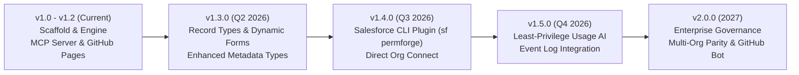

# 🗺️ PermForge Product & Technical Roadmap

This roadmap outlines the strategic direction, upcoming milestones, and architectural evolution of **PermForge** as the comprehensive, open-source Salesforce Profile-to-Permission Set migration and security platform.

---

## 🎯 Vision

Enable every Salesforce team—from small nonprofits to Fortune 500 enterprises—to seamlessly migrate from legacy monolith Profiles to a modular, Principle-of-Least-Privilege architecture before Salesforce's Profile Permissions Retirement deadline, with **0% downtime, 0% access disruption, and 100% mathematical parity verification**.

---

## 📅 Roadmap Overview



---

## 🚀 Milestones & Feature Breakdown

### Phase 1: Core Foundation & Agentic AI (v1.0 – v1.2) ✅ Completed
- [x] **Full CLI Suite (13 Commands)**: `analyze`, `cluster`, `decompose`, `verify`, `strip`, `uap`, `mute`, `lint`, `graph`, `report`, `plan`, `wizard`, `mcp`.
- [x] **Mathematical Parity Engine**: Bit-for-bit mathematical proof of equivalence between Profiles and Permission Set Groups.
- [x] **Cross-Profile Clustering**: Jaccard similarity baseline extraction (`Standard_Employee_Baseline` + role-specific deltas).
- [x] **Native Model Context Protocol (MCP) Server**: 9 tools exposed over JSON-RPC for Claude Desktop, Cursor, Antigravity, and Cline.
- [x] **Salesforce NPSP Real-World Validation**: Verified 100% parity against Salesforce Foundation's Nonprofit Success Pack profiles.
- [x] **Interactive Documentation Site**: Hosted on GitHub Pages with dark-mode terminal showcase and cheatsheet.

---

### Phase 2: Metadata Decoupling & Modern UI Architecture (v1.3.0) 🟡 In Progress
*Target: May 2026*

#### 1. Record Types & Dynamic Forms Modernization
- **Record Type Visibility in Permission Sets**: Migrate `recordTypeVisibilities` from profiles to domain permission sets, isolating `default` flags on profile stubs.
- **Dynamic Forms Decoupling Advisor**: Analyze layout assignments and recommend field sections for Salesforce Dynamic Forms migration, eliminating legacy Page Layout dependencies.

#### 2. Advanced Salesforce Metadata Support
- **Custom Metadata Types & Custom Settings**: Automate permission set generation for protected custom metadata types and list settings.
- **Flow & External Credential Access**: Modular permission sets for Flow definition access and Named Credential / External Credential principal access.

---

### Phase 3: Native Salesforce DX CLI Plugin & Direct Org Connect (v1.4.0) 🔵 Planned
*Target: August 2026*

#### 1. `@salesforce/plugin-permforge`
- Publish an official SF CLI plugin allowing admins and developers to run:
  ```bash
  sf permforge analyze --target-org my-sandbox
  sf permforge decompose --target-org my-sandbox --profile "Custom: Sales"
  sf permforge verify --target-org my-sandbox
  ```
- **Direct Tooling & Metadata API Querying**: Retrieve and analyze profile and permission set metadata directly in-memory via JSforce/Salesforce DX connection, eliminating manual `sf project retrieve` steps.

#### 2. Direct User Reassignment Automation
- **Bulk API 2.0 Assignment Runner**: Generate and execute `PermissionSetAssignment` and `PermissionSetGroupAssignment` records directly in target orgs with chunking and error handling.
- **Pre-Flight User Dry-Run**: Simulate user access changes against sandbox user records to catch licensing mismatches before deployment.

---

### Phase 4: Usage-Driven Least-Privilege AI Optimizer (v1.5.0) 🟣 Future
*Target: November 2026*

#### 1. Salesforce Event Monitoring & Audit Trail Analysis
- Ingest Salesforce Event Log Files (`LightningPageView`, `ApexExecution`, `URIEvent`, `RestApi`) and Field Audit Trails.
- Correlate granted profile permissions against actual user actions over 30/60/90 days.
- **Pruning Recommendations**: Automatically identify over-privileged users and generate Muting Permission Sets to strip unused grants without impacting daily workflows.

#### 2. AI-Assisted Permission Set Naming & Taxonomies
- Use LLM semantics to analyze custom object and field names to suggest business-aligned naming standards (e.g. `Billing_Operations_Read`, `Clinical_Trials_Admin`).

---

### Phase 5: Enterprise Governance & Multi-Org Parity (v2.0.0) 🟠 Long-Term
*Target: 2027*

#### 1. Multi-Org Parity & Drift Detection
- Cross-environment diff engine: compare permissions between Scratch Orgs &rarr; Sandboxes &rarr; UAT &rarr; Production.
- Detect out-of-band profile edits made directly in production Setup UI.

#### 2. PermForge GitHub App / PR Bot
- Automated GitHub Actions bot that runs on every pull request touching metadata.
- Posts interactive sticky comments on PRs showing:
  - Security complexity delta (+/- score)
  - Parity verification matrix
  - Immediate alert if any deprecated profile permission is introduced.

#### 3. Compliance & Audit Export Packages
- Ready-to-file compliance matrix exports for **SOC 2 Type II**, **HIPAA**, and **ISO 27001** demonstrating separation of duties and least-privilege enforcement.

---

## 🤝 Contributing to the Roadmap

Have ideas, feedback, or a unique enterprise use case?
- Join the discussion on [GitHub Discussions](https://github.com/visparashar/permforge/discussions).
- File feature requests using our [Feature Request Template](https://github.com/visparashar/permforge/issues/new?template=feature_request.md).
- Read the [Contributing Guide](CONTRIBUTING.md) to start building.
